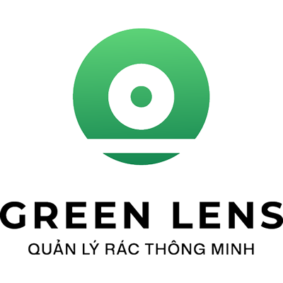

<div align="center">



# RecycleLens ♻️

**AI-Powered Waste Recognition & Environmental Learning Platform**  
*Identify waste with AI, learn responsible disposal practices, and build more sustainable habits.*


**[Overview](#-overview) · [Features](#-key-features) · [Architecture](#-system-architecture) · [Getting Started](#-getting-started) · [API](#-api--documentation) · [Documentation](#-project-documentation)**

</div>

---

## 🌍 Overview

**RecycleLens** is an environmental education platform that helps users identify waste from images, explore practical sorting and disposal guidance, discover sustainability-focused educational content, and track their learning journey through **gamification**.

This repository contains **two independently managed applications** within a single codebase:

| Application | Directory | Responsibility |
| --- | --- | --- |
| **Mobile App** | [`expo-recycle-lens/`](expo-recycle-lens/) | iOS/Android experience, camera integration, authentication, waste library, articles, profiles, and gamification |
| **Backend API** | [`nestjs-recycle-lens/`](nestjs-recycle-lens/) | REST APIs, authentication, AI Vision orchestration, data persistence, tenant isolation, and XP calculation |

> **Product principle:** AI-assisted recognition provides suggestions, not authoritative disposal instructions. Curated waste guidance and local collection regulations remain the primary references. Hazardous, uncertain, or unidentified waste must be handled with appropriate caution.

## ✨ Key Features

### 📷 AI Waste Scanner

- Capture waste images with the camera or select existing photos from the device gallery.
- Upload images to the NestJS backend for analysis through an integrated third-party Vision service.
- Display predicted waste information, suggested materials, contextual explanations, and safety considerations.
- Link recognized items to the curated waste library when a suitable canonical match is available.
- Maintain a **user-specific scan history** with access to previous results.
- Support an `Idempotency-Key` on analysis requests to reduce duplicate processing during retries.

### ♻️ Canonical Waste Library

- Search waste items by keyword, category, and material.
- Access structured disposal guidance covering preparation, collection, warnings, local considerations, and references.
- Keep curated waste records distinct from legacy environmental knowledge articles.
- Save frequently referenced waste items for quick access.

### 📚 Articles & Environmental Knowledge

- Explore educational articles about environmental protection and sustainable living.
- Search, filter by category, sort, and read detailed content.
- Distinguish between **Articles** (`post`) and **Environmental Knowledge** (`library` / legacy).
- Manage saved educational content.

### 🎮 Gamification — Your Green Journey

- **Eco XP & Levels:** earn qualifying experience points and track level progression calculated by the backend.
- **Waste Discoveries:** track waste types encountered through eligible activities.
- **Daily & Weekly Challenges:** follow challenges and receive rewards according to defined system rules.
- **Achievements:** monitor milestone progress and unlock badges.
- **Virtual Plant:** watch a virtual plant evolve as the user progresses.
- **XP History:** review an auditable history of awarded experience points.

> XP is awarded by **backend-defined eligibility rules**. Not every scan or article view automatically earns XP. See [`gamification.policy.ts`](nestjs-recycle-lens/src/gamification/gamification.policy.ts).

### 🔐 Accounts & User Experience

- Account registration, email/OTP verification, email/password sign-in, and password recovery.
- Google Sign-In on **native development or production builds**, subject to valid OAuth configuration.
- Profile management, avatar uploads, and password changes.
- JWT access/refresh token flows, authorization, and user/tenant-scoped data access.
- Onboarding, search, favorites, profile, and account settings.


### 🏗️ Architectural Principles

- **Modular backend:** `auth`, `users`, `vision`, `waste`, `articles`, `categories`, and `gamification` are organized around domain responsibilities.
- **Feature-based frontend:** each feature owns its screens, components, API integration, hooks, and types; Expo Router manages navigation.
- **Server-owned business rules:** authentication, authorization, resource ownership, canonical waste data, and XP policies are enforced by the backend.
- **Multi-tenant isolation:** the `x-tenant-id` header identifies a **server-configured PostgreSQL database binding**. Each tenant must use a separate database; clients never provide database connection strings.
- **AI output is not canonical guidance:** generated analysis can be incorrect, so curated disposal instructions are maintained independently.

### Repository Structure

```text
expo-recycle-lens/
├── expo-recycle-lens/             # Expo / React Native application
│   ├── src/
│   │   ├── app/                  # Expo Router: public, protected, tabs
│   │   ├── features/             # auth, scan, home, waste-library,
│   │   │                         # articles, gamification, profile...
│   │   ├── providers/            # Authentication, Query, app providers
│   │   ├── shared/               # API client, UI, storage, utilities
│   │   └── config/
│   ├── assets/
│   ├── app.config.ts
│   ├── .env.example
│   └── package.json
├── nestjs-recycle-lens/           # NestJS REST API
│   ├── src/
│   │   ├── identities/           # Authentication, users, admin
│   │   ├── vision/               # Image processing & AI integration
│   │   ├── waste/                # Canonical waste library
│   │   ├── articles/
│   │   ├── categories/
│   │   ├── gamification/
│   │   ├── prisma/
│   │   └── common/               # Tenant resolution, shared concerns
│   ├── prisma/                   # Schema, migrations, seed
│   ├── test/
│   ├── .env.example
│   └── package.json
└── docs/                          # Architecture, API, setup, QA reports
```

## 🧰 Technology Stack

| Layer | Technologies |
| --- | --- |
| Mobile | **Expo SDK 55**, React Native 0.83, React 19, TypeScript |
| Navigation & UI | Expo Router, NativeWind 4, Tailwind CSS 3, Iconsax, `expo-image`, `react-native-svg` |
| Client state & networking | Zustand, TanStack Query 5, Axios, Zod |
| Device integration | Expo Camera, Image Picker, SecureStore, native Google Sign-In |
| Backend | **NestJS 11**, Node.js, REST, Swagger/OpenAPI, Passport/JWT |
| Database & ORM | **PostgreSQL**, **Prisma 7**, `@prisma/adapter-pg` |
| Media & integrations | Cloudinary, third-party Vision service, email provider (Resend/SMTP), Google OAuth |
| Code quality & testing | TypeScript, ESLint, Jest, Supertest, Prisma migrations |

## 🚀 Getting Started

### 1. Prerequisites

- **Git**, **Node.js**, and **npm**. **Node.js 24.x** is recommended based on the environment previously used to validate this project with Prisma 7. The repository does not currently pin Node.js through an `.nvmrc` file.
- A **PostgreSQL** instance, either local or managed (e.g., Neon), with a dedicated development database and migration privileges.
- **Android Studio + Android SDK** for Android development; **macOS + Xcode** for iOS development.
- Valid provider configuration and credentials for the integrations you intend to test: email, Google OAuth, Cloudinary, and AI Vision.
- Two terminals to run the backend and mobile application concurrently.

### 2. Clone the Repository

```bash
git clone git@github.com:WadeY0/expo-recycle-lens.git
cd expo-recycle-lens

# The work branch contains newer RecycleLens features and technical documentation.
# Check it out if it is the branch your team currently develops against.
git checkout work
```

The repository is currently **private**. Your GitHub account must have access. Use the HTTPS clone URL if SSH is not configured.

### 3. Backend — Installation & Configuration

```bash
cd nestjs-recycle-lens
npm ci --include=dev
cp .env.example .env
```

Populate `nestjs-recycle-lens/.env` with **valid development environment values**:

| Area | Environment variables |
| --- | --- |
| Application & database | `NODE_ENV`, `FRONTEND_URL`, `DATABASE_URL`, `DATABASE_URL_RECYCLELENS` |
| JWT | `JWT_SECRET`, `JWT_REFRESH_TOKEN_SECRET`, `JWT_TOKEN_AUDIENCE`, `JWT_TOKEN_ISSUER`, `JWT_ACCESS_TOKEN_TTL`, `JWT_REFRESH_TOKEN_TTL` |
| Email | `RESEND_API_KEY`, `EMAIL_FROM`, `EMAIL_HOST`, `EMAIL_PORT`, `EMAIL_USERNAME`, `EMAIL_PASSWORD` |
| OAuth | `GOOGLE_CLIENT_ID`, `GOOGLE_CLIENT_SECRET`, `GOOGLE_CALLBACK_URL` |
| Media | `CLOUDINARY_CLOUD_NAME`, `CLOUDINARY_API_KEY`, `CLOUDINARY_API_SECRET`, `BASE_URL` |
| AI Vision | `CHAT_DOMAIN`, `CHATBOT_CODE`, `CHATBOT_CODE_GREENLEN` |

**Database configuration:**

- `DATABASE_URL` determines the **Prisma CLI target** for migrations, status checks, and default seed execution.
- `DATABASE_URL_RECYCLELENS` is the **runtime database binding** for tenant `RECYCLELENS`.
- Additional tenants require their own `DATABASE_URL_<TENANT_ID>` binding and a **separate PostgreSQL database**, which must be migrated independently.
- Never bind multiple tenants to the same database or silently fall back to another tenant's database when a connection fails.
- The backend validates environment configuration during startup. Several JWT, OAuth, and email variables are required by its current validation schema, even when testing only a subset of features.

**Database migrations:** Before applying schema changes, verify that `DATABASE_URL` points to the intended **development database**. Back up existing data before modifying an established database.

```bash
# From nestjs-recycle-lens/
npx prisma generate
npx prisma migrate status

# Run only after confirming the target database:
npx prisma migrate deploy
```

**Optional development seed:** Run only against an already-migrated **development/test database**. Seeding does not automatically apply migrations or reset the database.

```bash
# Seed the database selected by DATABASE_URL
npm run seed

# Alternatively, target a configured tenant explicitly
npm run seed -- --tenant=RECYCLELENS
```

See the [Demo Setup Guide](docs/RECYCLELENS_DEMO_SETUP.md) from the repository root for sample data and safe use of the development demo account. **Never run demo seed data against production.**

**Start the backend:**

```bash
npm run dev
```

- Default API base URL: **`http://localhost:5005`**, unless overridden by `PORT`.
- Swagger UI outside production: **`http://localhost:5005/docs`**.
- The backend listens on `0.0.0.0` to support access from development devices and networks.

### 4. Mobile — Installation & Configuration

Open a **second terminal** at the repository root:

```bash
cd expo-recycle-lens
npm ci
cp .env.example .env
```

Configure `expo-recycle-lens/.env`:

```dotenv
EXPO_PUBLIC_APP_ENV=development
EXPO_PUBLIC_API_URL=http://<REACHABLE_BACKEND_HOST>:5005
EXPO_PUBLIC_TENANT_ID=RECYCLELENS
EXPO_PUBLIC_CLOUDINARY=https://res.cloudinary.com/<CLOUD_NAME>/image/upload/
EXPO_PUBLIC_KEY_GOOGLE_WEB=<YOUR_GOOGLE_WEB_CLIENT_ID>
EXPO_PUBLIC_KEY_GOOGLE_IOS=<YOUR_GOOGLE_IOS_CLIENT_ID>
```

Values in angle brackets (`<...>`) are **placeholders**, not immediately usable configuration. All `EXPO_PUBLIC_*` values are bundled into client-side code. **Never place JWT secrets, database credentials, provider API secrets, or Cloudinary API secrets in Expo environment variables.**

**Choose the appropriate API URL for your device:**

| Environment | Example `EXPO_PUBLIC_API_URL` |
| --- | --- |
| Android emulator | `http://10.0.2.2:5005` when the backend runs on the host machine |
| iOS simulator | `http://localhost:5005` when accessible from the simulator |
| Physical device | `http://192.168.x.x:5005` using the backend machine's LAN IP, or a public HTTPS endpoint |
| Remote backend | `https://<your-api-domain>` |

> On a **physical phone**, `localhost` refers to the phone—not the computer running NestJS. Ensure the device can reach the backend, review firewall and native HTTP cleartext policies as needed, and prefer HTTPS when accessing the service over public networks.

**Run the mobile application:**

```bash
# Start the Expo / Metro development server
npm start

# Android native development build
npm run android

# iOS: requires macOS and Xcode
# Use the Expo CLI to select the appropriate simulator or device.
npx expo run:ios

# Web preview (not a substitute for native testing)
npm run web
```

**Note:** Native Google Sign-In requires a **development or production native build**; it is not fully supported in Expo Go. OAuth client IDs, the app's Android package/iOS bundle identifier, and signing fingerprints must match the build configuration. See [`GOOGLE_SIGNIN_SETUP.md`](expo-recycle-lens/GOOGLE_SIGNIN_SETUP.md).

### 5. Quick Smoke Test

After both applications start with valid configuration:

1. Register or sign in to an account under the intended tenant.
2. Verify the Home screen, Profile, Waste Library, Search, and Articles.
3. Open content details and test saving/removing favorites.
4. Test camera/gallery uploads and scanning once AI Vision and Cloudinary are properly configured.
5. Review scan history, XP, levels, achievements, challenges, and the virtual plant.
6. Sign out, sign back in, and ensure no data leaks between different users or tenants.

> A successful build or API startup **does not establish that real AI providers, email delivery, Google Sign-In, or device-specific flows have been validated**. Test these integrations separately.

## 🔌 API & Documentation

Representative endpoints (JWT authentication is required where enforced by the controller):

| Domain | Example endpoints |
| --- | --- |
| Authentication | `/auth/...`, `/users/me` |
| Vision | `POST /vision/analyze-waste`, `GET /vision/my`, `GET /vision/my/:id` |
| Waste Library | `GET /waste`, `GET /waste/filters`, `GET /waste/:id` |
| Waste Favorites | `GET /waste/favorites`, `PUT/DELETE /waste/:id/favorite` |
| Articles | `GET /articles`, `GET /articles/liked`, `GET /articles/:id` |
| Article Favorites | `PUT/DELETE /articles/:id/favorite` |
| Gamification | `GET /gamification/overview`, `GET /gamification/xp-history`, `GET /gamification/discoveries`, `GET /gamification/achievements`, `GET /gamification/challenges`, `GET /gamification/plant` |

- **Swagger/OpenAPI:** `http://localhost:5005/docs` in non-production environments.
- **Tenant header:** `x-tenant-id: RECYCLELENS`. This selects a server-configured database binding; it does **not** grant arbitrary access to other databases.
- **Authentication:** `Authorization: Bearer <access_token>` for authenticated endpoints.
- **Idempotency:** send `Idempotency-Key` with image analysis uploads to reduce unintended duplicate processing.

For endpoint contracts, schemas, and domain rules, refer to the documentation under [`docs/`](docs/).

## 🔐 Security & Data Safety

- JWT/session validity and tenant access are enforced by the backend; client-side logic does not determine access rights or XP awards.
- Each tenant uses a separate PostgreSQL database. Frontend session and cache keys are scoped by tenant and, where applicable, user.
- Scan history is user-specific and accessed through ownership-protected endpoints.
- Store secrets only in backend environment configuration or a secrets manager. Never commit `.env` files or expose secrets through `EXPO_PUBLIC_*` variables.
- Uploaded images currently use publicly accessible Cloudinary URLs. **Database-level tenant isolation does not make those media URLs private or tenant-ACL-protected.**
- Recycling and disposal guidance is educational and must be checked against local collection requirements, particularly for hazardous waste.

## 📖 Project Documentation

- [Deployment & Multi-Tenant Configuration](docs/RECYCLELENS_DEPLOYMENT_GUIDE.md)
- [Development Demo & Seed Data](docs/RECYCLELENS_DEMO_SETUP.md)
- [Manual Testing Checklist](docs/RECYCLELENS_MANUAL_TEST_CHECKLIST.md)
- [Foundation & Security Report](docs/RECYCLELENS_FOUNDATION_REPORT.md)
- [AI Vision Integration Notes](docs/RECYCLELENS_THIRD_PARTY_VISION_REPORT.md)
- [Source Audit](docs/RECYCLELENS_SOURCE_AUDIT.md)
- [Google Sign-In (Native)](expo-recycle-lens/GOOGLE_SIGNIN_SETUP.md)

> Some documents under `docs/` describe **historical project milestones**. When documentation differs, use the current source code and deployment guide as the authoritative implementation reference.

## 📝 Project Status & Licensing

RecycleLens is under active development and iterative testing. The presence of source code and setup instructions **does not imply full validation on physical devices, live third-party providers, or production infrastructure**.

This repository is currently **private**. The backend package declares `UNLICENSED`, and no public license file is present at the repository root. Obtain permission from the repository owner before reusing or distributing any part of the codebase.

---

<div align="center">

**RecycleLens — Scan smarter. Learn greener. ♻️**

*Built with Expo, NestJS, Prisma, and PostgreSQL.*

</div>
